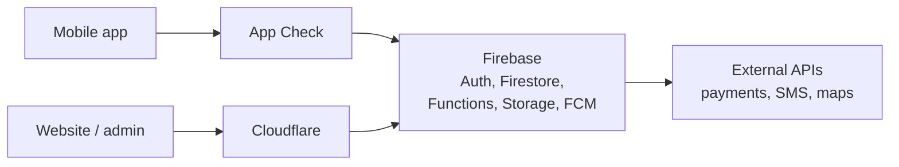

# Firebase Serverless Stack: Core Technologies

> Knowledge notes: the core technologies for starting a mobile app backend on Firebase (plus Cloudflare for the web), what each one is, why to choose it, and the system design ideas behind it.

| # | Technology | Role |
|---|---|---|
| 1 | **Node.js + TypeScript** (Cloud Functions) | Backend logic |
| 2 | **Cloud Firestore** | Database |
| 3 | **Firebase Auth** | Sign-in and users |
| 4 | **Cloud Storage for Firebase** | Files |
| 5 | **Firebase Cloud Messaging (FCM)** | Push notifications |
| 6 | **Firebase App Check** | Abuse protection |
| 7 | **Cloudflare** | Web edge: DNS, CDN, WAF, bot protection |

**Core pattern: "clients read, functions write".** Apps read the database directly (fast, real-time). Every important change goes through a function, and security rules stop clients writing that data themselves.

---

## 1. Node.js + TypeScript (Cloud Functions)

**What:** serverless functions. You write functions; Google runs, scales and patches them. 2nd gen runs on Cloud Run (many requests per instance, `minInstances` to avoid cold starts).

**Types of functions:**
- **Callable** (`onCall`): the app calls them like normal functions; auth is included.
- **HTTP** (`onRequest`): webhooks from other services.
- **Triggers:** run when a document changes; this is the app's event system.
- **Scheduled** (`onSchedule`): cron jobs.

**Why choose it:**
- No servers to manage; pay per use.
- TypeScript on both client and server, so validation and business rules can be **shared** as one package.
- Triggers give event-driven design for free.

**Watch out:** cold starts; triggers can run more than once, so handlers must be **idempotent**.

## 2. Cloud Firestore

**What:** a NoSQL document database (collections → documents → subcollections) with real-time listeners and an offline cache.

**Why choose it:**
- **Real-time:** screens update without polling or sockets.
- **Offline:** mobile apps keep working with no signal.
- **Transactions:** safe updates when many users act at once.
- Scales automatically.

**Design rules:**
- **Model for the screens**, not for normalization: copy data where it's read (denormalize).
- Split **public and private** data into separate documents (rules protect whole documents, not fields).
- Avoid **hot documents** (about 1 sustained write per second per document).
- Keep growing lists in **subcollections**, not arrays (1 MiB document limit).
- No built-in geo search; use **geohash** range queries.
- Cost = **document reads**, so keep queries narrow and use `limit`.

## 3. Firebase Auth

**What:** managed authentication: phone OTP, email/password, Google, Apple, anonymous.

**Why choose it:**
- Secure sign-in without building OTP, tokens or refresh logic.
- **Custom claims** for roles (`admin: true`), checked in rules and functions.
- **Identity Platform** upgrade adds MFA, blocking functions (before sign-up/sign-in hooks) and an SMS region policy.

**Tips:**
- Restrict SMS to your country's numbers to stop **SMS pumping** fraud.
- Use **anonymous auth** for guests, so every request has a user id that can be rate-limited.

## 4. Cloud Storage for Firebase

**What:** object storage for files, with Storage Security Rules.

**Why choose it:**
- Apps upload directly (no server in between), with type and size checks in rules.
- Storage triggers process files after upload (thumbnails, metadata removal).
- Public files are served through Google's CDN.

**Tips:**
- Keep identity documents **private**: let users upload but not read them back, and give staff short-lived **signed URLs** that are logged.

## 5. Firebase Cloud Messaging (FCM)

**What:** a free push notification service for Android, iOS and web.

**Why choose it:**
- One API for all platforms (iOS through APNs).
- Sent from functions with the Admin SDK, usually from a trigger when data changes.

**Tips:**
- Store device tokens per user and delete invalid ones after failed sends.
- Separate **critical** messages (security codes, payments), which always send, from **marketing**, which respects opt-outs and quiet hours.

## 6. Firebase App Check

**What:** verifies that requests come from your genuine app or website, using Play Integrity (Android), App Attest (iOS) and reCAPTCHA (web).

**Why choose it:**
- Blocks bots, scripts and modified apps **before** your code runs.
- Protects functions, Firestore and Storage with one setting each.
- Essential when guests can use the app without signing in.

**Layered security around it:**
- Security Rules that **deny by default**
- Rate limits per user and IP
- MFA for admins
- Billing budget alerts

## 7. Cloudflare

**What:** a network in front of your web domains: DNS, CDN, DDoS protection, WAF, rate limiting, bot management.

**Why choose it:**
- **Security at the edge:** attacks are blocked before they reach your site.
- **Rate limiting** on login and form endpoints.
- **Turnstile:** a free, privacy-friendly CAPTCHA.
- **Cloudflare Access:** zero-trust login in front of admin tools.
- **Speed:** caching close to users; "Under Attack" mode for emergencies.

**Important:** Cloudflare protects **web traffic to your domains**. Mobile apps using the Firebase SDKs talk to Google directly, so protect them with **App Check**.

---

## System design concepts

| Concept | Meaning | How it applies here |
|---|---|---|
| **Serverless** | No servers to manage; pay per use | Cloud Functions + Firestore |
| **Event-driven** | Components react to events instead of calling each other | Firestore triggers, Pub/Sub, timers |
| **CQRS-lite (read/write split)** | Reads and writes take different paths | Clients read directly; functions do all important writes |
| **Modular design** | Code split by feature with clear boundaries | One folder per feature; shared rules package |
| **Denormalization** | Copy data where it's read, to avoid joins | Names and photos copied into related documents |
| **Strong consistency where it matters** | Use transactions for the critical paths | Prevent double booking and "two winners" |
| **Idempotency** | Repeating a request has no extra effect | Request ids; dedupe for webhooks and triggers |
| **Saga / process manager** | A long process run step by step with timers | Multi-step flows with delayed jobs (Cloud Tasks) |
| **Hot spots** | One record written too often becomes a bottleneck | Avoid global counters; spread writes; aggregate in BigQuery |
| **Caching** | Keep copies close to the user | CDN (Cloudflare), the app's offline cache, in-memory config cache |
| **Rate limiting** | Cap requests per user or IP | Protects cost and stops abuse |
| **Defense in depth** | Several security layers, each catching some attacks | Edge → App Check → Auth → rate limits → Security Rules |
| **Graceful degradation** | Keep working when a dependency fails | Fallback channels, simpler logic when an external API is down |
| **Observability** | Know what the system is doing | Structured logs, error reporting, metrics, alerts |
| **Cost awareness** | Design affects the bill | Fewer, smaller reads; budget alerts |

---

## When this stack fits

| Good fit | Think twice |
|---|---|
| Mobile-first apps that need real-time updates and offline support | Heavy relational reporting with many joins (use BigQuery alongside) |
| Small teams that don't want to run servers | Very high write rates on single records |
| Fast start, pay as you grow | Strict need for SQL constraints |

**Common add-ons later:**
- Cloud Tasks (delayed jobs)
- Cloud Scheduler (cron)
- BigQuery (analytics)
- Remote Config (feature flags)
- Typesense/Algolia (search)
